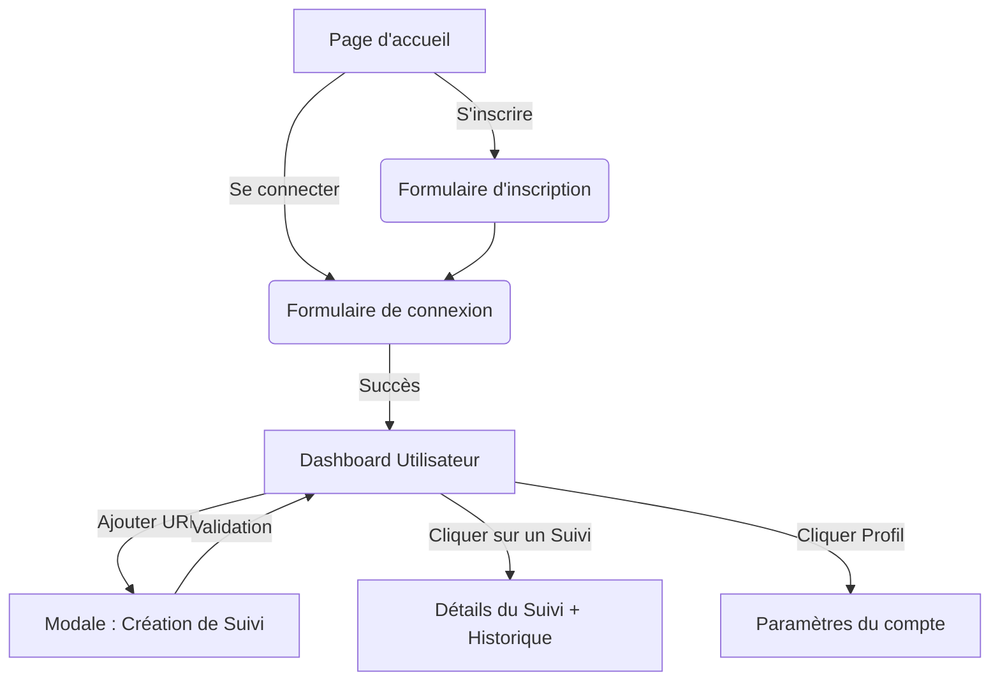
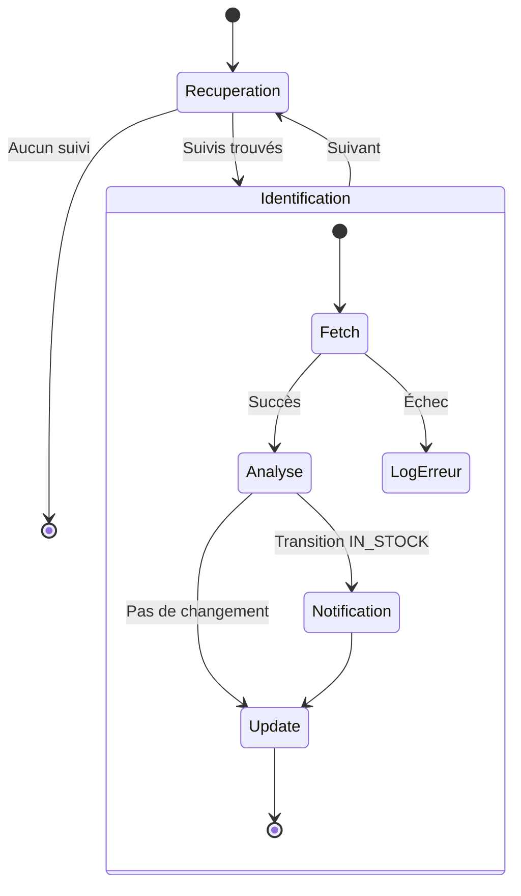
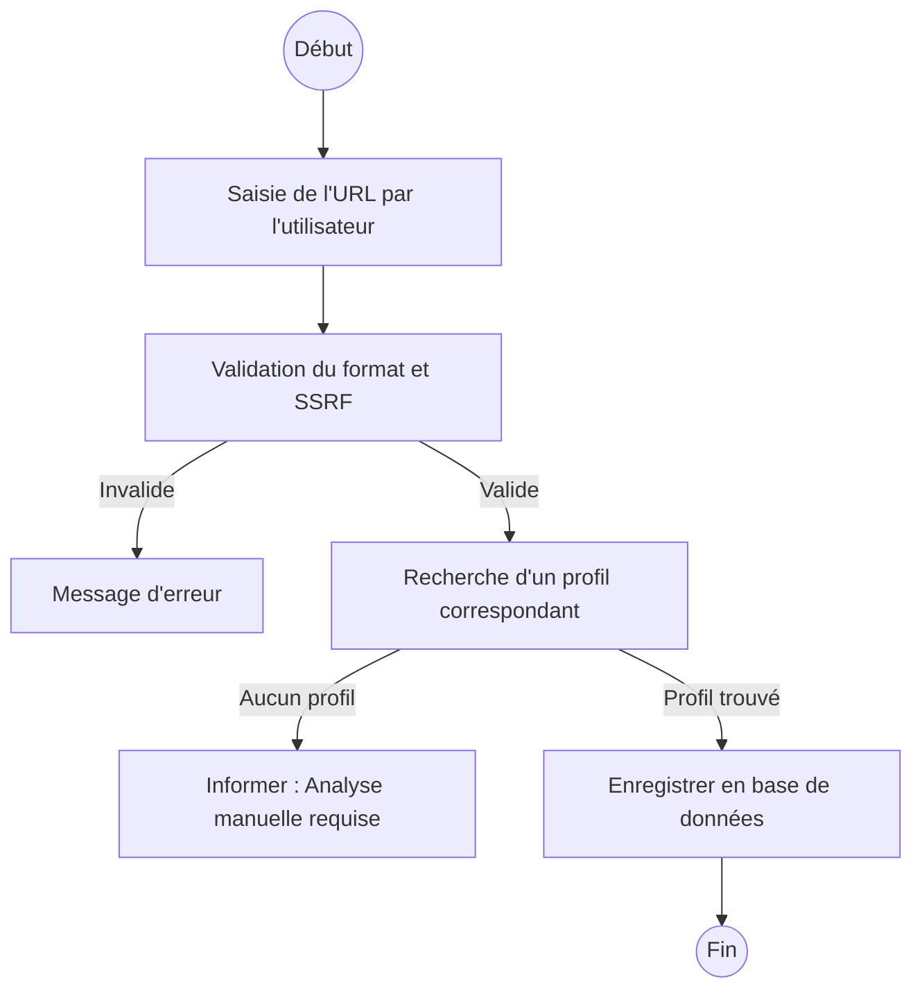

# Nova - User Flow & Diagrammes d'activités

## User Flow (Enchaînement logique des écrans)
Le flux suivant décrit le parcours type d'un utilisateur sur l'application Nova :

## Diagrammes d'activités

### 1. Processus de vérification de stock (Worker)
Ce diagramme détaille la logique interne du worker lors d'un cycle de vérification.

### 2. Ajout d'un suivi par l'utilisateur

