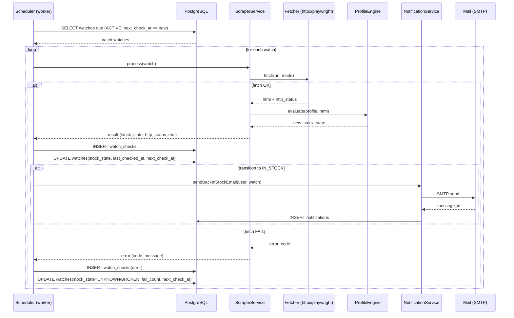
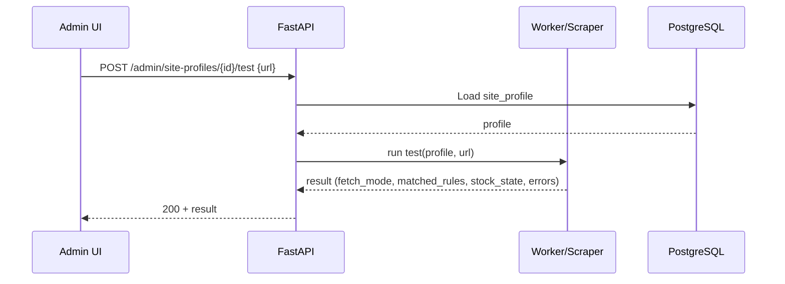
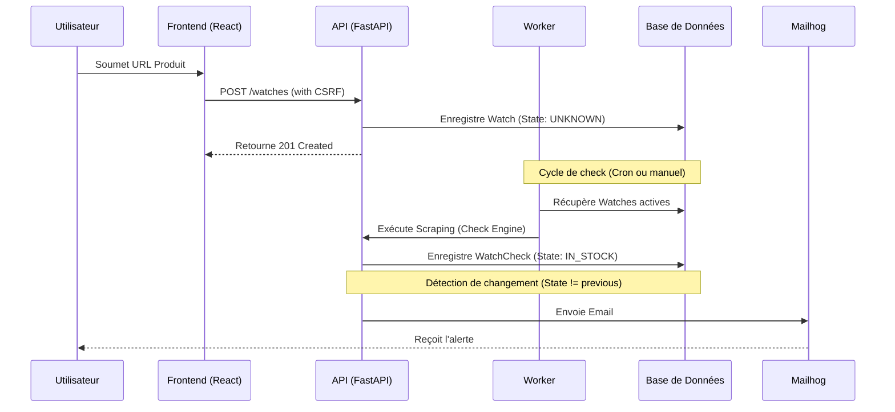

# Nova - UML - Séquences

## Séquence 1 — Contrôle stock + notification

## Séquence 2 — Admin “Test profil sur URL”

## Séquence 3 — Flux complet (Action utilisateur → Notification)
Ce diagramme synthétise le parcours complet, de la création d'un suivi par l'utilisateur à la réception de l'alerte email par le worker.

