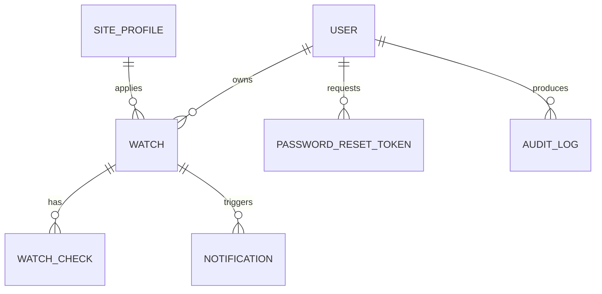

# Nova - MCD (modèle conceptuel)

## Entités (conceptuel)
- **User** : compte (email, rôle)
- **Watch (Suivi)** : suivi d’un produit (URL normalisée, statut, état stock)
- **SiteProfile** : règles de détection associées à un domaine/motif
- **WatchCheck** : historique des contrôles (résultat + erreur)
- **Notification** : envoi d’alertes (email)
- **PasswordResetToken** : jeton de réinitialisation de mot de passe (token, expiration)
- **AuditLog** : traces admin/sécurité

## Relations & cardinalités
- User (1) — (0..n) Watch
- SiteProfile (1) — (0..n) Watch
- Watch (1) — (0..n) WatchCheck
- Watch (1) — (0..n) Notification
- User (1) — (0..n) PasswordResetToken
- User (1) — (0..n) AuditLog

## Diagramme (Mermaid ERD)

