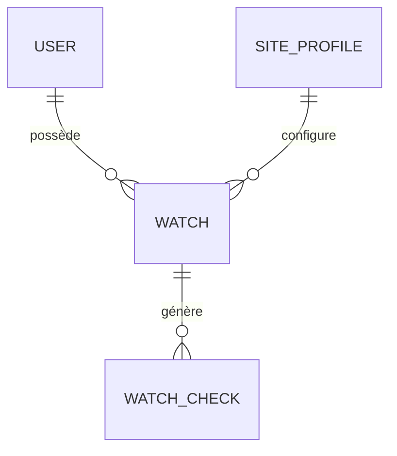
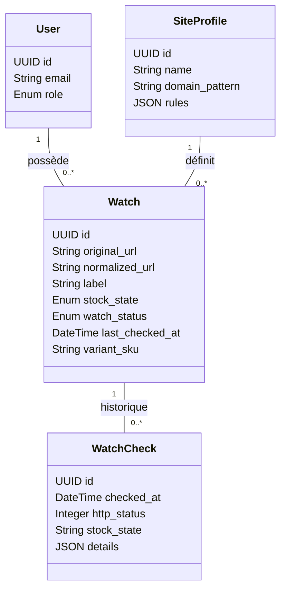

# Nova - MCD (modèle conceptuel)

## Entités (conceptuel)
- **User** : Compte utilisateur identifié par son email.
- **Watch (Suivi)** : Produit surveillé par un utilisateur (URL, statut, dernier état connu).
- **SiteProfile** : Configuration de détection (sélecteurs CSS/JSON) associée à un domaine.
- **WatchCheck** : Historique technique d'une vérification effectuée.

## Relations & cardinalités
- Un **User** possède 0 à n **Watch**.
- Une **Watch** appartient à un seul **User**.
- Un **SiteProfile** peut s'appliquer à 0 à n **Watch**.
- Une **Watch** génère 0 à n **WatchCheck** au cours du temps.

## Diagramme (Mermaid ERD)

## Diagramme de Classes (Aligné sur Nova V2)

