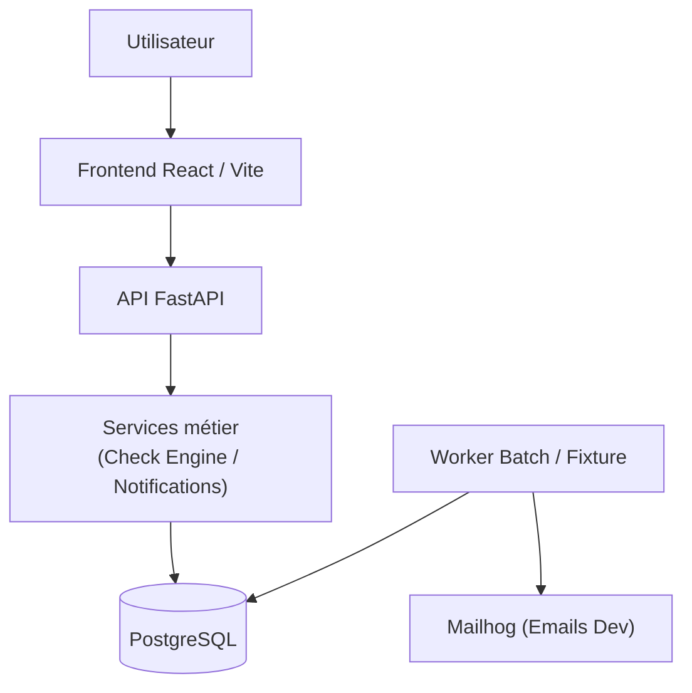
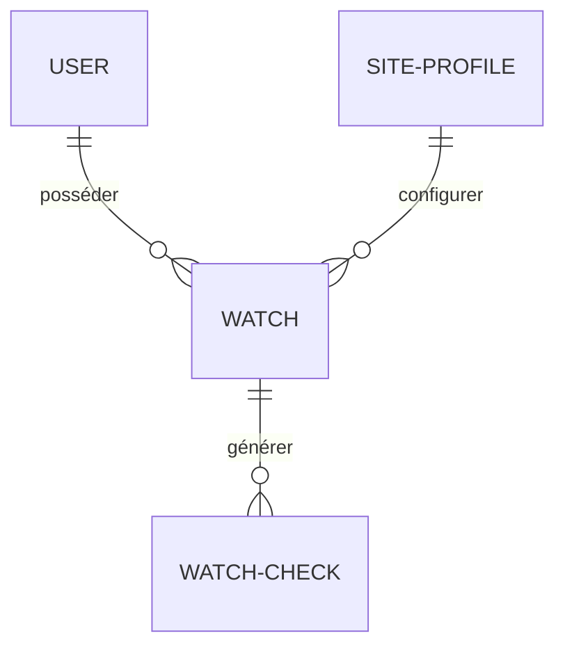

# Nova
## Application de suivi de disponibilité produit

  
    Christopher Perez  
    Rattrapage CDA
  

<!--
Notes orateur :
- Bonjour à tous, je m'appelle Christopher Perez.
- Aujourd'hui je vous présente Nova, mon projet pour le titre CDA.
- C'est une application de veille de stock e-commerce.
-->

---
transition: fade-out
---

# Sommaire

1. **Contexte et besoin** : Pourquoi Nova ?
2. **Périmètre V2** : Évolutions et corrections
3. **Fonctionnalités** : Démonstration du coeur de métier
4. **Architecture & Modélisation** : Choix techniques et structure
5. **Sécurité & Qualité** : Garantir la robustesse
6. **Démonstration** : Cas d'usage concret
7. **Compétences CDA** : Bilan du projet

<!--
Notes orateur :
- Le but de cette présentation est de vous montrer comment Nova a évolué vers une version 2 plus stable et professionnelle.
-->

---

# 1. Contexte et besoin

### Pourquoi Nova existe ?
Le commerce en ligne est marqué par des ruptures de stock fréquentes sur des produits à forte demande (high-tech, mode, etc.).

### Problème utilisateur
- Perte de temps à vérifier manuellement plusieurs sites.
- Manque de réactivité face au retour en stock.

### Objectif fonctionnel
- **Centraliser** la veille sur un tableau de bord unique.
- **Déclencher** des vérifications et historiser les résultats.
- **Préparer** une logique de notification via email.

<!--
Notes orateur :
- Nova répond à un besoin simple : automatiser la surveillance de produits pour ne plus rater un achat.
-->

---

# 2. Périmètre V2

### Un objectif de fiabilité et de maîtrise technique
La V2 corrige les instabilités de la V1 et stabilise le périmètre pour une démonstration robuste.

#### ✅ Inclus en V2 (Correctif)
- Authentification sécurisée (JWT/CSRF).
- Moteur de vérification déterministe (Mode Fixture).
- Notifications Mailhog intégrées.
- Dockerisation complète et simplifiée.
- Refonte graphique (React, Vite, TypeScript, Tailwind).

#### ❌ Hors périmètre (V3)
- Administration avancée.
- Notifications in-app.
- Support multi-sites robuste.
- Scheduler configurable.
- Monitoring.
- Application mobile.

<!--
Notes orateur :
- La V1 était un POC fragile dépendant du web réel.
- La V2 se concentre sur la robustesse technique et la démonstration de mes compétences CDA.
-->

---

# 3. Fonctionnalités principales

*   **Authentification complète** : Inscription, connexion, protection des routes.
*   **Tableau de bord** : Vue d'ensemble des suivis (état, prix, dates).
*   **Création d'un suivi** :
    *   Analyse d'URL (Preview produit).
    *   Sélection de variantes (SKU).
*   **Détail & Historique** : État courant, prix, dates et historique des vérifications.
*   **Vérification manuelle** : Déclenchement immédiat d'un check.
*   **Système d'alertes** : Tester une logique de notification en environnement de développement via Mailhog.

<!--
Notes orateur :
- L'application couvre tout le cycle de vie d'un suivi produit.
- [CAPTURE D'ÉCRAN : Dashboard Nova V2]
-->

---

# 4. Architecture technique

La stack est moderne, modulaire et entièrement conteneurisée.

- **Frontend** : React, Vite, Tailwind CSS.
- **Backend** : FastAPI (Python), asynchrone par nature.
- **Base de données** : PostgreSQL avec SQLAlchemy / Alembic.
- **Infrastructure** : Docker Compose pour l'orchestration.

<!--
Notes orateur :
- Séparation claire des responsabilités (Frontend vs Backend).
- Utilisation de FastAPI pour sa rapidité et sa doc Swagger automatique.
-->

---

# 5. Modélisation des données

Une structure relationnelle cohérente pour répondre aux besoins métier.

- **User** : Gestion des comptes et rôles.
- **Watch** : L'entité coeur (URL, SKU, état actuel).
- **WatchCheck** : Historique immuable de chaque vérification.
- **SiteProfile** : Règles de parsing dynamiques.

<!--
Notes orateur :
- J'ai revu la modélisation (MCD/MLD) pour qu'elle soit parfaitement alignée avec le code.
- Chaque check est historisé pour permettre de futurs graphiques d'évolution de prix.
-->

---

# 6. Sécurité

### Maîtrise des fondamentaux
- **Authentification** : JWT stocké en cookie `HttpOnly` (Anti-XSS).
- **CSRF** : Protection par Double Submit Cookie sur les routes mutatives.
- **Pydantic** : Validation stricte des schémas de données (Backend).
- **Routes protégées** : Accès restreint selon l'état d'authentification.
- **Isolation des données** : Association stricte des suivis à l'utilisateur.
- **Hashage** : Mots de passe sécurisés en base de données.

<!--
Notes orateur :
- La sécurité n'est pas une option. J'ai appliqué des protections classiques attendues sur une application web : cookie HttpOnly, CSRF, validation backend et routes protégées.
- [CAPTURE D'ÉCRAN : Middleware CSRF ou Swagger montrant les verrous]
-->

---

# 7. Qualité et tests

### Fiabiliser le cycle de développement
- **Tests unitaires & intégration** : Framework `pytest`.
- **Mode Fixture** : Utilisation de fichiers HTML locaux pour garantir une démonstration stable indépendamment des changements sur le web réel.
- **Documentation API** : Swagger/OpenAPI disponible nativement pour les tests front-end.
- **Linting** : Ruff/ESLint pour la cohérence du code.
- **Build frontend** : validation de la génération de production avec Vite.
- **Docker** : Reproductibilité garantie de l'environnement.

<!--
Notes orateur :
- Les tests m’ont permis de sécuriser le parcours principal et de vérifier que les corrections de la V2 ne cassent pas les fonctionnalités existantes.
- Le mode fixture est ma réponse à l'instabilité du web lors d'un examen.
-->

---

# 8. Démonstration (Plan)

1. **Infrastructure** : Lancement rapide via `docker-compose`.
2. **Authentification** : Connexion à l'espace membre.
3. **Dashboard** : Consultation de la liste des suivis.
4. **Création** : Simulation d'ajout de produit avec preview.
5. **Check Engine** : Lancement d'un worker sur une fixture "Rupture de stock".
6. **Alerte** : Vérification d'un email de développement dans Mailhog.
7. **API** : Consultation rapide des routes via Swagger.

<!--
Notes orateur :
- Le scénario de démo est conçu pour durer 10-15 minutes et montrer chaque compétence du titre CDA.
-->

---

# 9. Difficultés rencontrées

| Challenge | Solution apportée |
| :--- | :--- |
| **Instabilité du Web** | Création du moteur de fixtures HTML pour la démo. |
| **Sécurité JWT/CSRF** | Implémentation manuelle du middleware de sécurité. |
| **Modélisation complexe** | Refonte complète du MCD/MLD après retour jury V1. |
| **Dockerisation** | Optimisation des Dockerfiles (multi-stage) pour la performance. |
| **Design / UX** | Adoption de Tailwind CSS pour un rendu professionnel. |

<!--
Notes orateur :
- Le passage de la V1 à la V2 a été un véritable exercice de refactoring et de prise de recul technique.
-->

---

# 10. Compétences CDA mobilisées

| Bloc | Réalisation Nova |
| :--- | :--- |
| **Concevoir** | Diagrammes UML et modélisation SQL. |
| **Développer Front** | SPA React avec gestion d'état et Tailwind. |
| **Développer Back** | API REST FastAPI et services métier. |
| **Gestion de projet** | Backlog, versioning Git, documentation. |
| **Sécuriser** | JWT HttpOnly, CSRF, routes protégées, validation Pydantic. |
| **Tests & Qualité** | Suite Pytest et Dockerisation. |

<!--
Notes orateur :
- Ce projet me permet de démontrer un parcours complet : analyse, conception, développement, sécurisation, tests et environnement reproductible.
-->

---

# Conclusion

### Ce que Nova démontre
- Ma capacité à concevoir une architecture logicielle complète.
- La maîtrise d'une stack technique moderne et demandée (Python/React).
- Une démarche de qualité (tests, sécurité, documentation).

### Apprentissage
- Importance de la préparation de la donnée de démo (fixtures).
- Rigueur nécessaire sur la sécurité des échanges API.

### Futur de Nova (V3)
- Administration avancée et notifications in-app.
- Support multi-sites robuste et scheduler configurable.
- Monitoring et application mobile.

<!--
Notes orateur :
- Merci pour votre attention. Avez-vous des questions ?
-->
